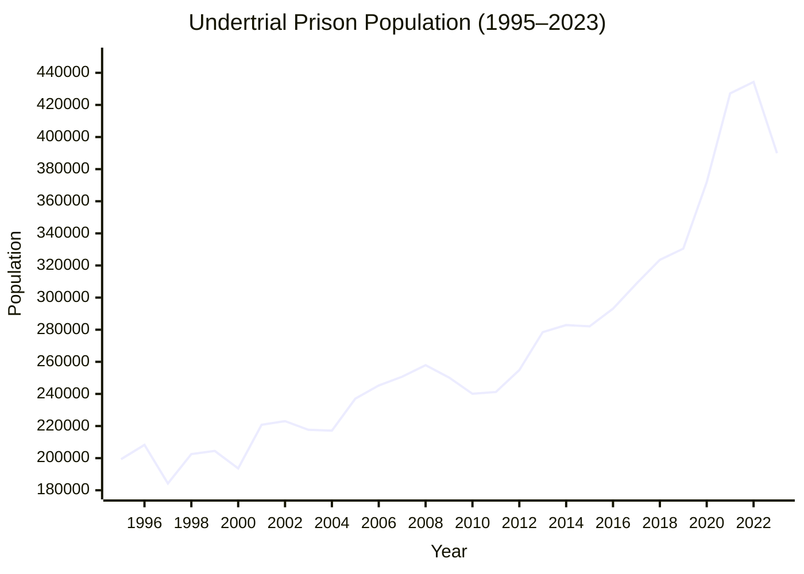
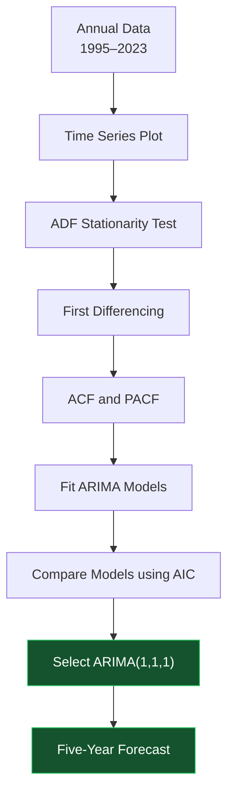

# Undertrial Prison Population Forecasting

### ARIMA-Based Time Series Analysis of India's Undertrial Prison Population

This project analyses the historical trend of India's undertrial prison population and applies **ARIMA (AutoRegressive Integrated Moving Average)** to model the series and forecast future population levels.

The analysis demonstrates how time-series techniques can be used to study social and administrative trends.

---

## Historical Time Series

The historical series shows an overall increasing trend in India's undertrial prison population, with fluctuations across years.

The chart includes all 29 annual observations from 1995 to 2023. The numeric year axis is used to keep the year labels spaced and readable.

---

## Time Series Methodology

The analysis follows these steps:

1. Load and prepare the annual time series
2. Visualize the historical series
3. Test stationarity using the Augmented Dickey–Fuller (ADF) test
4. Apply first-order differencing
5. Examine ACF and PACF
6. Fit ARIMA models
7. Compare candidate models using AIC
8. Perform residual diagnostics
9. Forecast the next five years

### Forecasting Workflow

---

## Stationarity and Differencing

The **Augmented Dickey–Fuller (ADF) test** was used to check whether the series was stationary.

- **H₀:** The series contains a unit root.
- **H₁:** The series is stationary.

The original series was non-stationary. First-order differencing was applied:

$$
\Delta Y_t = Y_t - Y_{t-1}
$$

After differencing, the series became stationary.

---

## ACF and PACF

The Autocorrelation Function (ACF) and Partial Autocorrelation Function (PACF) of the differenced series were examined to understand the dependence structure and guide ARIMA model selection.

---

## ARIMA Model

ARIMA combines autoregressive, differencing, and moving-average components.

The general mathematical representation is:

$$
\phi(B)(1-B)^dY_t = c + \theta(B)\varepsilon_t
$$

Where:

- \(p\) = Autoregressive order
- \(d\) = Differencing order
- \(q\) = Moving-average order
- \(B\) = Backshift operator
- \(\varepsilon_t\) = Random error

The selected model was **ARIMA(1,1,1)** with a linear trend.

---

## Model Selection

Candidate models were compared using the Akaike Information Criterion (AIC).

$$
AIC = -2\ln(L) + 2k
$$

Where:

- \(L\) = Maximum likelihood
- \(k\) = Number of estimated parameters

A lower AIC indicates a better balance between model fit and complexity.

| Model | AIC |
|---|---:|
| ARIMA(1,1,0) | 635.789 |
| ARIMA(0,1,1) | 636.168 |
| **ARIMA(1,1,1)** | **634.410** |

ARIMA(1,1,1) had the lowest AIC among the compared models and was selected for forecasting.

---

## Residual Diagnostics

Residual diagnostics were used to check whether the fitted model adequately captured the time-series structure.

| Test | Purpose |
|---|---|
| Ljung–Box Test | Checks residual autocorrelation |
| Jarque–Bera Test | Checks residual normality |
| Breusch–Pagan Test | Checks constant error variance |

The Ljung–Box test did not indicate significant residual autocorrelation at the tested lag. The Jarque–Bera test indicated a departure from normality, while the Breusch–Pagan test did not provide significant evidence of heteroscedasticity at the 5% level.

---

## Five-Year Forecast

The selected ARIMA(1,1,1) model was used to forecast the next five annual periods.

| Year | Forecast Population |
|---|---:|
| 2024 | 390,494 |
| 2025 | 400,361 |
| 2026 | 405,660 |
| 2027 | 413,207 |
| 2028 | 419,647 |

The forecast indicates a gradual increase in the undertrial prison population over the forecast horizon.

---

## Conclusion

This project demonstrates the application of time-series analysis and ARIMA modeling to India's undertrial prison population.

The original series was non-stationary and became stationary after first-order differencing. After examining autocorrelation patterns and comparing candidate models using AIC, ARIMA(1,1,1) was selected as the preferred specification.

The model captures the broad historical movement of the series and provides a five-year forecast extending to 2028.

---

## Author

**Ananya Aggrawal**
