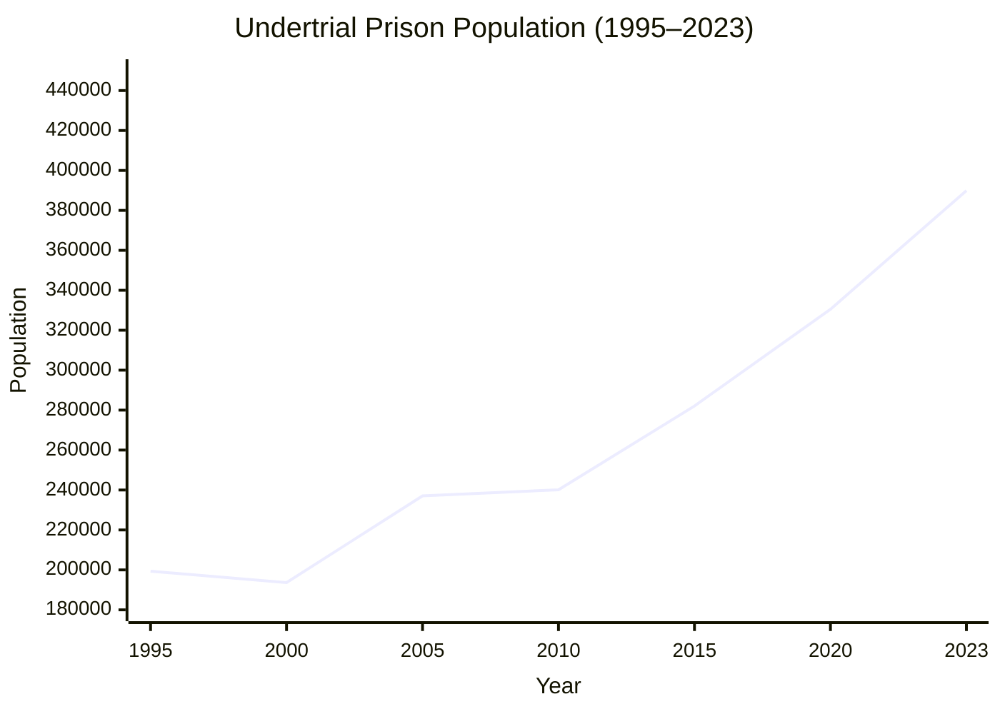

## 📈 Historical Time Series

The historical series shows an overall increasing trend in India's undertrial prison population, with fluctuations across years.

The population increased substantially over the observed period, particularly after 2017.
