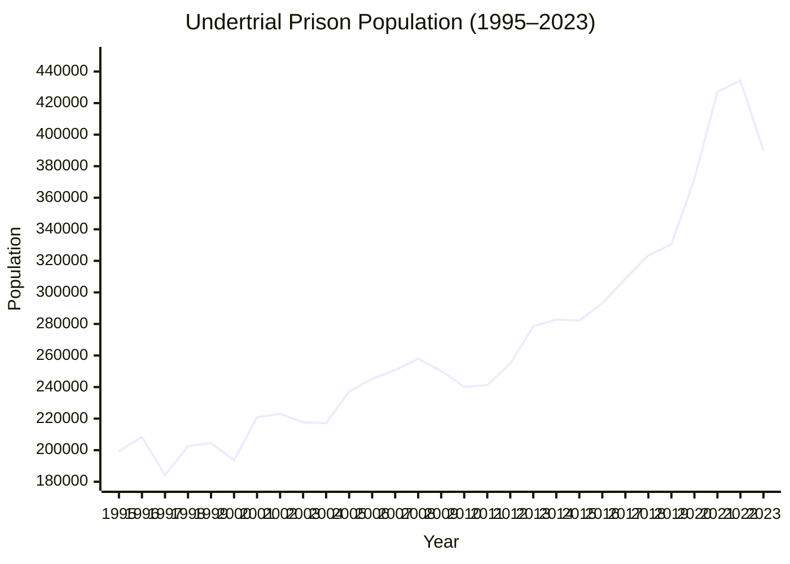
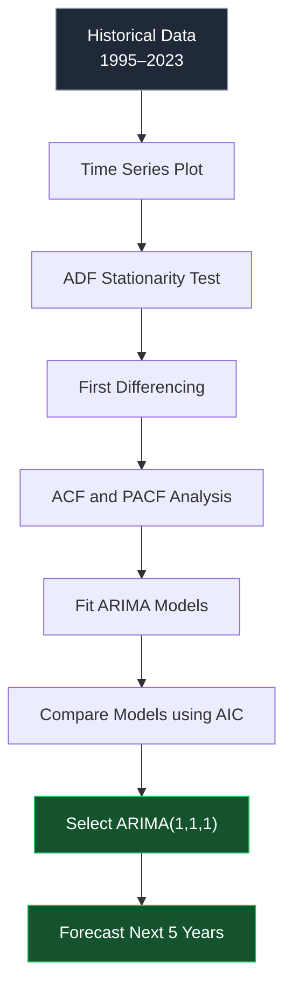
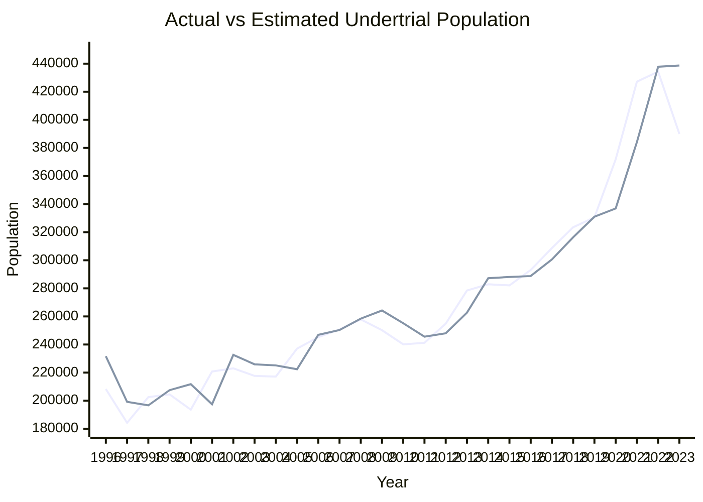
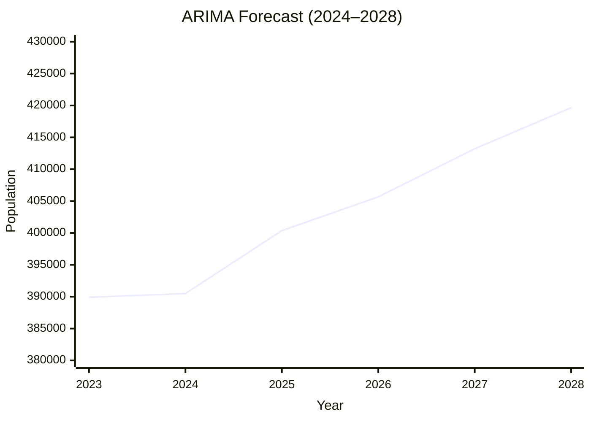

# ⚖️ Undertrial Prison Population Forecasting

### Time Series Analysis and ARIMA Forecasting of India's Undertrial Prison Population

This project analyses the historical trend of India's undertrial prison population and applies **ARIMA (AutoRegressive Integrated Moving Average)** to model the series and forecast future population levels.

The objective is to understand the historical movement of the undertrial population and explore how time-series forecasting can support data-driven planning and policy discussions.

---

## 📊 About the Dataset

The dataset contains annual observations of India's undertrial prison population.

| Dataset Information | Details |
|---|---|
| Variable | Undertrial Prison Population |
| Time Period | 1995–2023 |
| Total Observations | 29 |
| Frequency | Annual |
| Target Variable | Number of Undertrials |

The dataset records the yearly number of individuals held in prisons while awaiting the completion of their trials.

---

## 📈 Historical Time Series

The historical series shows an overall increasing trend in India's undertrial prison population, with fluctuations across years.

The population increased substantially over the observed period, particularly after 2017.

---

## 🧠 Time Series Methodology

The analysis follows these steps:

1. Data loading and time-index preparation
2. Visualization of the historical time series
3. Stationarity testing using the Augmented Dickey–Fuller (ADF) test
4. First-order differencing
5. ACF and PACF analysis
6. ARIMA model fitting
7. Model comparison using AIC
8. Five-period forecasting

### Forecasting Workflow

---

## 🔬 Stationarity — Augmented Dickey–Fuller Test

The ADF test was used to determine whether the time series was stationary.

**Hypotheses:**

$$
H_0: \text{The series has a unit root}
$$

$$
H_1: \text{The series is stationary}
$$

The original series was non-stationary, with an ADF p-value of approximately **0.9932**.

First-order differencing was applied:

$$
\Delta Y_t = Y_t - Y_{t-1}
$$

After differencing, the ADF p-value was approximately **0.000195**, indicating stationarity at the 5% significance level.

---

## 📉 ACF and PACF Analysis

The Autocorrelation Function (ACF) and Partial Autocorrelation Function (PACF) were examined to understand the dependence structure of the differenced series and guide ARIMA model selection.

---

## 📐 ARIMA Model

ARIMA combines autoregressive, differencing, and moving-average components.

The general mathematical representation is:

$$
\phi(B)(1-B)^dY_t = c + \theta(B)\varepsilon_t
$$

Where:

- $p$ = Order of the autoregressive component
- $d$ = Degree of differencing
- $q$ = Order of the moving-average component
- $B$ = Backshift operator
- $\varepsilon_t$ = Random error
- $\phi(B)$ = AR polynomial
- $\theta(B)$ = MA polynomial

The selected model was:

**ARIMA(1,1,1)**

The model includes one autoregressive term, first-order differencing, and one moving-average term, with a linear trend.

---

## 🔍 Model Selection

Three ARIMA specifications were compared using the Akaike Information Criterion (AIC).

$$
AIC = -2\ln(L) + 2k
$$

Where:

- $L$ = Maximum likelihood
- $k$ = Number of estimated parameters

A lower AIC indicates a better balance between model fit and complexity.

| Model | AIC |
|---|---:|
| ARIMA(1,1,0) | 635.789 |
| ARIMA(0,1,1) | 636.168 |
| **ARIMA(1,1,1)** | **634.410** |

ARIMA(1,1,1) had the lowest reported AIC among the three models and was selected for forecasting.

---

## 🧪 Residual Diagnostics

Residual diagnostics were used to examine whether the fitted model adequately captured the time-series structure.

| Diagnostic | Result | Interpretation |
|---|---:|---|
| Ljung–Box Test p-value | 0.30 | No significant residual autocorrelation detected at lag 1 |
| Jarque–Bera Test p-value | 0.27 | No significant departure from normality detected |
| Heteroscedasticity Test p-value | 0.12 | No significant evidence of changing residual variance |

These results suggest that the fitted model's residuals did not show significant problems in the reported diagnostic tests at the 5% level.

---

## 📊 Actual vs Estimated Population

The fitted values from ARIMA(1,1,1) were compared with the observed undertrial population.

The chart below shows **two series in order: actual population, followed by estimated population**.

The fitted values capture the broad historical movement of the series, including its overall upward trend and major fluctuations.

---

## 🔮 Five-Year Forecast

The selected ARIMA(1,1,1) model was used to forecast the next five annual periods.

| Year | Forecast Population |
|---|---:|
| 2024 | 390,494 |
| 2025 | 400,361 |
| 2026 | 405,660 |
| 2027 | 413,207 |
| 2028 | 419,647 |

### Forecast Trend

The forecast indicates a gradual increase in the undertrial prison population over the next five years.

---

## 🏁 Conclusion

This project demonstrates the application of time-series analysis and ARIMA modeling to study and forecast India's undertrial prison population.

The original series was non-stationary and was made stationary through first-order differencing. After examining autocorrelation patterns and comparing candidate models using AIC, ARIMA(1,1,1) was selected as the preferred specification.

The model captures the broad historical movement of the series and provides a five-year forecast extending to 2028.

Overall, the analysis demonstrates how statistical time-series techniques can be applied to study important social and administrative trends.

---

## 👩‍💻 Author

**Ananya Aggrawal**
