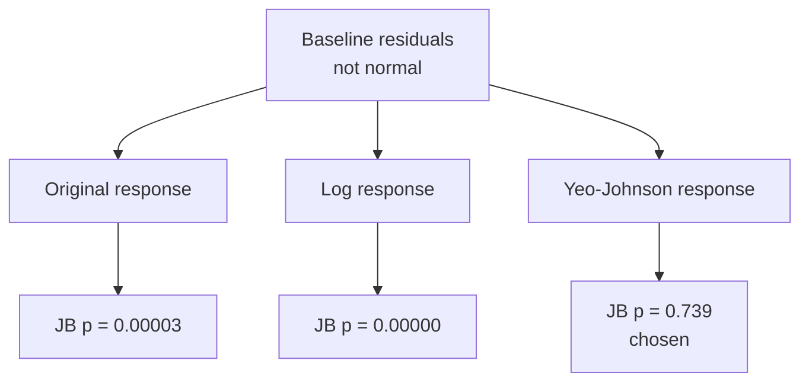

# 🌍 Determinants of Life Expectancy — Multiple Linear Regression
 


 
**Author:** Ananya Aggarwal
 
Why do people in some countries live twenty years longer than people in others? This project builds a multiple linear regression model that explains and predicts **life expectancy** from health, immunization, demographic, economic and social indicators for 193 countries, then checks whether regularized models (Ridge, Lasso, Elastic Net) can do better.
 
---
 
## 📌 Highlights
 
- **Cross-sectional design.** The raw data follow each country from 2000 to 2015. Repeated observations of the same country are not independent, which breaks a basic assumption of ordinary least squares. The model therefore uses **one year only (2010)**, chosen after an audit of missing values.
- **Assumption-driven workflow.** Multicollinearity (VIF), heteroscedasticity (Breusch–Pagan), normality (Jarque–Bera), autocorrelation (Durbin–Watson) and influential points (Cook's distance, leverage, R-student) were all checked.
- **Response transformation.** A Yeo–Johnson transformation fixed non-normal residuals. The Jarque–Bera p-value went from about 0.00003 to 0.74.
- **Honest evaluation.** Preprocessing was learned on the training set only, and every model was tested on countries it had never seen.
 
---
 
## 🗂️ Dataset
 
| Property | Value |
|---|---|
| Records | 2,938 country-year rows |
| Variables | 22 |
| Countries | 193 |
| Period | 2000 – 2015 |
| Target | `Life expectancy` (years) |
| Modelling year | 2010 (183 countries) |
 
The dataset is the commonly used WHO life-expectancy dataset with economic and social indicators.
 
| Group | Variables |
|---|---|
| **Identifiers** | Country, Year, Status (Developed / Developing) |
| **Mortality** | Adult Mortality, infant deaths, under-five deaths, HIV/AIDS |
| **Immunization** | Hepatitis B, Polio, Diphtheria, Measles |
| **Lifestyle and nutrition** | Alcohol, BMI, thinness 1–19 years, thinness 5–9 years |
| **Economy and health spending** | GDP, percentage expenditure, Total expenditure, Population |
| **Social development** | Income composition of resources, Schooling |
 
### Why 2010?
 
The audit of missing values by year showed that 2015 is unusable for a clean regression. Out of 183 countries, 181 have no `Total expenditure` value and 177 have no `Alcohol` value. The years from 2000 to 2014 are far more complete, and 2010 gives a stable, well-populated cross-section of 183 countries.
 
---
 
## 🔄 Workflow
 

 
---
 
## 📚 Theory
 
### 1. Multiple Linear Regression
 
The model describes life expectancy as a linear combination of $p$ predictors:
 
$$
y_i = \beta_0 + \beta_1 x_{i1} + \beta_2 x_{i2} + \dots + \beta_p x_{ip} + \varepsilon_i, \qquad \varepsilon_i \sim \mathcal{N}(0, \sigma^2)
$$
 
In matrix form, $\mathbf{y} = \mathbf{X}\boldsymbol{\beta} + \boldsymbol{\varepsilon}$.
 
### 2. Ordinary Least Squares (OLS)
 
OLS chooses the coefficients that minimize the sum of squared residuals:
 
$$
\hat{\boldsymbol{\beta}} = \arg\min_{\boldsymbol{\beta}} \sum_{i=1}^{n} (y_i - \mathbf{x}_i^{\top}\boldsymbol{\beta})^2 = (\mathbf{X}^{\top}\mathbf{X})^{-1}\mathbf{X}^{\top}\mathbf{y}
$$
 
### 3. Assumptions and how each was checked
 
| Assumption | Why it matters | Check used |
|---|---|---|
| No severe multicollinearity | Unstable, hard-to-interpret coefficients | Variance Inflation Factor (VIF) |
| Constant error variance | Reliable standard errors and p-values | Breusch–Pagan test |
| Normally distributed errors | Valid confidence intervals and tests | Jarque–Bera test, Q–Q plot |
| Uncorrelated errors | Independent observations | Durbin–Watson statistic |
| No unduly influential points | A few countries should not drive the fit | R-student, leverage, Cook's distance |
 
**Variance Inflation Factor**, where $R_j^2$ comes from regressing predictor $j$ on all the others:
 
$$
\mathrm{VIF}_j = \frac{1}{1 - R_j^2}
$$
 
**Jarque–Bera** compares the skewness $S$ and kurtosis $K$ of the residuals with those of a normal distribution:
 
$$
JB = \frac{n}{6}\left(S^2 + \frac{(K-3)^2}{4}\right)
$$
 
**Durbin–Watson**, where values near 2 indicate no autocorrelation:
 
$$
DW = \frac{\sum_{t=2}^{n}(e_t - e_{t-1})^2}{\sum_{t=1}^{n} e_t^2}
$$
 
**Cook's distance** measures how much the fitted values change when observation $i$ is removed. Here $h_{ii}$ is the leverage of observation $i$:
 
$$
D_i = \frac{e_i^2}{p\,\hat{\sigma}^2}\cdot\frac{h_{ii}}{(1-h_{ii})^2}
$$
 
### 4. Transformations
 
**Log transform for right-skewed predictors.** `log1p` is used so that zeros stay valid:
 
$$
x' = \ln(1 + x)
$$
 
**Yeo–Johnson transform for the response.** It works for any real $y$ and picks $\lambda$ by maximum likelihood. Since life expectancy is always positive, only the first two branches apply:
 
$$
\psi(y,\lambda)=
\begin{cases}
\dfrac{(y+1)^{\lambda}-1}{\lambda}, & y \ge 0,\ \lambda \neq 0 \\[2mm]
\ln(y+1), & y \ge 0,\ \lambda = 0 \\[2mm]
-\dfrac{(1-y)^{2-\lambda}-1}{2-\lambda}, & y < 0,\ \lambda \neq 2 \\[2mm]
-\ln(1-y), & y < 0,\ \lambda = 2
\end{cases}
$$
 
### 5. Regularization
 
Regularized models add a penalty on coefficient size. This shrinks coefficients, controls variance and handles correlated predictors. Predictors are standardized first so the penalty treats them fairly.
 
| Model | Objective (penalty added to the squared error) |
|---|---|
| **Ridge** | $\lambda \sum_j \beta_j^2$ |
| **Lasso** | $\lambda \sum_j \lvert\beta_j\rvert$ |
| **Elastic Net** | $\lambda\left[\alpha \sum_j \lvert\beta_j\rvert + \dfrac{1-\alpha}{2}\sum_j \beta_j^2\right]$ |
 
The penalty strength and the Elastic Net mix were tuned with **5-fold cross-validation**, minimizing RMSE.
 
### 6. Evaluation metrics
 
$$
R^2 = 1 - \frac{\sum_i (y_i - \hat{y}_i)^2}{\sum_i (y_i - \bar{y})^2}
\qquad
R^2_{adj} = 1 - (1-R^2)\frac{n-1}{n-p-1}
$$
 
$$
MAE = \frac{1}{n}\sum_{i=1}^{n} \lvert y_i - \hat{y}_i \rvert
\qquad
RMSE = \sqrt{\frac{1}{n}\sum_{i=1}^{n} (y_i - \hat{y}_i)^2}
$$
 
---
 
## 🧹 Data Preparation
 
1. **Cleaning.** Column names were trimmed, duplicate rows removed and numeric columns coerced.
2. **Missingness before imputation.** Predictors with more than 25% missing values were to be excluded. In 2010 none crossed that threshold. The most affected were `Population` (21.9%), `GDP` (14.8%) and `Hepatitis B` (8.2%).
3. **Redundant predictors removed.** Two pairs were almost perfectly correlated, so one variable from each was dropped:
 
   | Pair | Correlation | Dropped |
   |---|---|---|
   | infant deaths vs under-five deaths | 0.997 | infant deaths |
   | thinness 1–19 vs thinness 5–9 years | 0.974 | thinness 5–9 years |
 
4. **Train/test split.** 80/20, stratified by development status, with `random_state=42`. This gives **146 training** and **37 test** countries.
5. **Median imputation.** The medians come from the training set only and are applied unchanged to the test set, so no information leaks from test to train.
6. **Log transform.** `log1p` was applied to predictors with skewness above 1:
 
   | Predictor | Skewness before | Skewness after |
   |---|---|---|
   | percentage expenditure | 4.56 | −0.36 |
   | Measles | 9.68 | 0.44 |
   | HIV/AIDS | 3.88 | 2.00 |
   | GDP | 3.49 | −0.39 |
   | Population | 4.68 | −0.54 |
   | thinness 1–19 years | 1.42 | 0.16 |
 
---
 
## 🔬 Modelling
 
### Baseline OLS
 
| Diagnostic | Value | Reading |
|---|---|---|
| Adjusted R² | 0.857 | Strong fit |
| Max VIF | 3.95 | No serious multicollinearity |
| Breusch–Pagan p | 0.550 | No evidence of heteroscedasticity |
| Durbin–Watson | 1.97 | No autocorrelation |
| Jarque–Bera p | 0.00003 | Residuals are not normal |
 
The only failed check was normality of the residuals, so a response transformation was tested.
 
### Choosing the response transformation
 

 
| Response | Adj. R² | Breusch–Pagan p | Jarque–Bera p | Durbin–Watson |
|---|---|---|---|---|
| Original | 0.8573 | 0.5499 | 0.0000 | 1.9656 |
| Log | 0.8383 | 0.1231 | 0.0000 | 2.0727 |
| **Yeo–Johnson** | **0.8531** | **0.4593** | **0.7389** | **1.8391** |
 
The log transform made no real difference to normality and cost some fit. Yeo–Johnson ($\lambda \approx 2.92$) kept the adjusted R² high and brought the residuals to normality.
 
### Refined OLS (Yeo–Johnson response)
 
| Statistic | Value |
|---|---|
| R² / Adjusted R² | 0.870 / 0.853 |
| F-statistic | 50.52 (p ≈ 2.5 × 10⁻⁴⁸) |
| Max VIF | 3.95 (Schooling) |
| Breusch–Pagan p | 0.459 |
| Jarque–Bera p | 0.739 |
| Durbin–Watson | 1.839 |
 
**Predictors significant at the 5% level**
 
| Predictor | Direction | p-value |
|---|---|---|
| Adult Mortality | Negative | < 0.001 |
| HIV/AIDS | Negative | < 0.001 |
| percentage expenditure (log) | Positive | 0.005 |
| Income composition of resources | Positive | 0.006 |
| Status: Developed | Positive | 0.004 |
 
`Polio` was borderline (p = 0.058). The remaining predictors were not individually significant once the others were in the model.
 
### Influential observations
 
One observation (index 1834) was flagged with an R-student of 3.30. Its leverage (0.125) and Cook's distance (0.080) were modest, so it was **kept**: it is an outlier in the response but does not unduly influence the fit.
 
### Regularized models
 
Hyperparameters picked by 5-fold cross-validation:
 
| Model | Selected parameters |
|---|---|
| Ridge | $\lambda \approx 21.54$ |
| Lasso | $\lambda = 1.0$ |
| Elastic Net | $\lambda \approx 0.215$, L1 ratio = 0.05 |
 
---
 
## 📊 Results
 
### Training performance (146 countries)
 
| Model | R² | Adj. R² | MAE | RMSE |
|---|---|---|---|---|
| Refined OLS | 0.8611 | 0.8427 | 2.588 | 3.459 |
| Lasso | 0.8611 | 0.8427 | 2.588 | 3.459 |
| Ridge | 0.8589 | 0.8401 | 2.569 | 3.486 |
| Elastic Net | 0.8564 | 0.8374 | 2.575 | 3.516 |
 
### Out-of-sample performance (37 unseen countries)
 
| Rank | Model | R² | MAE (years) | RMSE (years) |
|---|---|---|---|---|
| 🥇 | **Ridge** | **0.7226** | **3.698** | **4.857** |
| 🥈 | Elastic Net | 0.7221 | 3.710 | 4.861 |
| 🥉 | Lasso | 0.7158 | 3.771 | 4.915 |
| 4 | Refined OLS | 0.7158 | 3.772 | 4.915 |
 
On unseen countries, the best model predicts life expectancy to within roughly **3.7 years on average** and explains about **72%** of the variation.
 
---
 
## ✅ Conclusion
 
- **What drives life expectancy.** Adult mortality and HIV/AIDS burden are strongly associated with shorter lives. Income composition of resources, health spending and developed-country status are associated with longer lives.
- **The model is statistically sound.** After the Yeo–Johnson transformation, all checked OLS assumptions hold: no serious multicollinearity (max VIF 3.95), no heteroscedasticity, normal residuals and no autocorrelation.
- **Regularization helps only slightly.** All four models perform alike. Ridge has a small numerical edge, but the gaps between models are minor, and Ridge's advantage comes from shrinkage rather than from selecting variables.
- **Generalization gap.** R² falls from 0.86 on training data to 0.72 on unseen countries. With only 37 test countries, this estimate is noisy, so the results should be read as indicative rather than exact.
- **Interpretation caveat.** The model describes associations in one year (2010), not causal effects. Predictors such as mortality and spending reflect overlapping aspects of national development.
 
**Possible extensions:** repeated cross-validation to stabilize the test estimate, panel models that use all 16 years, and non-linear or tree-based models for comparison.
 
---
 
## 🚀 Run It
 
```bash
pip install numpy pandas matplotlib seaborn scipy statsmodels scikit-learn jupyter
jupyter notebook Life_Expectancy_Linear_Regression_Project.ipynb
```
 
The notebook reads `Life Expectancy Data.csv`, so keep both files in the same folder.
 
